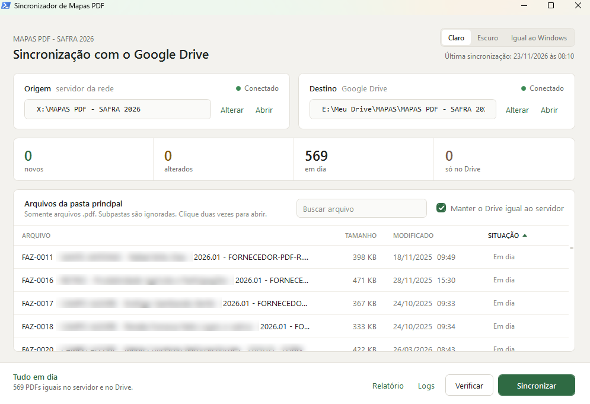
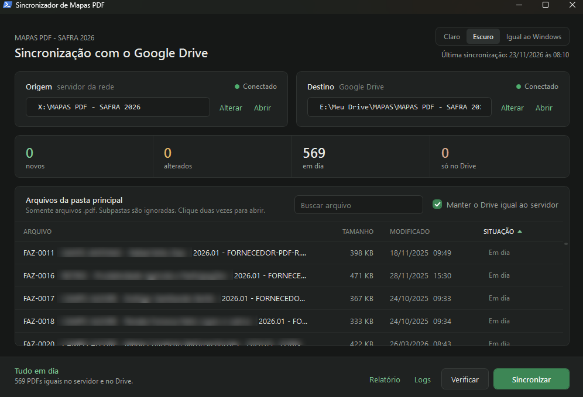
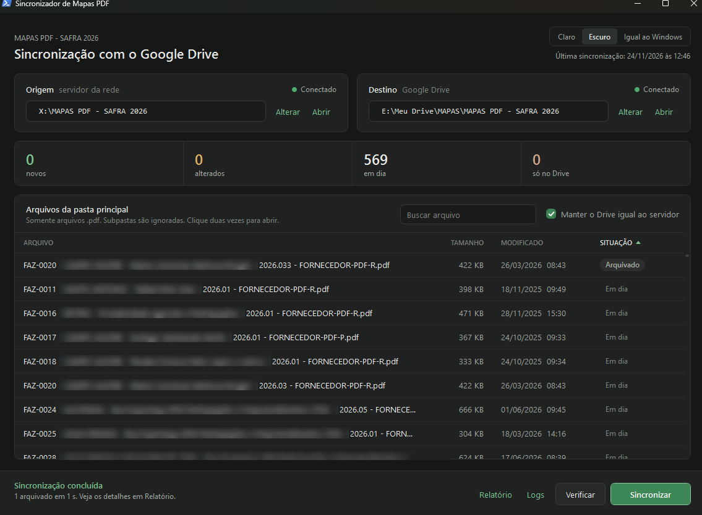
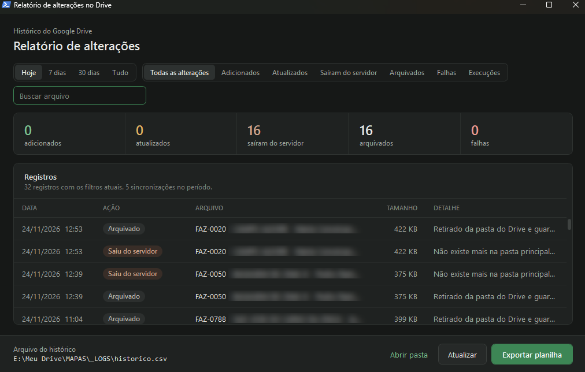
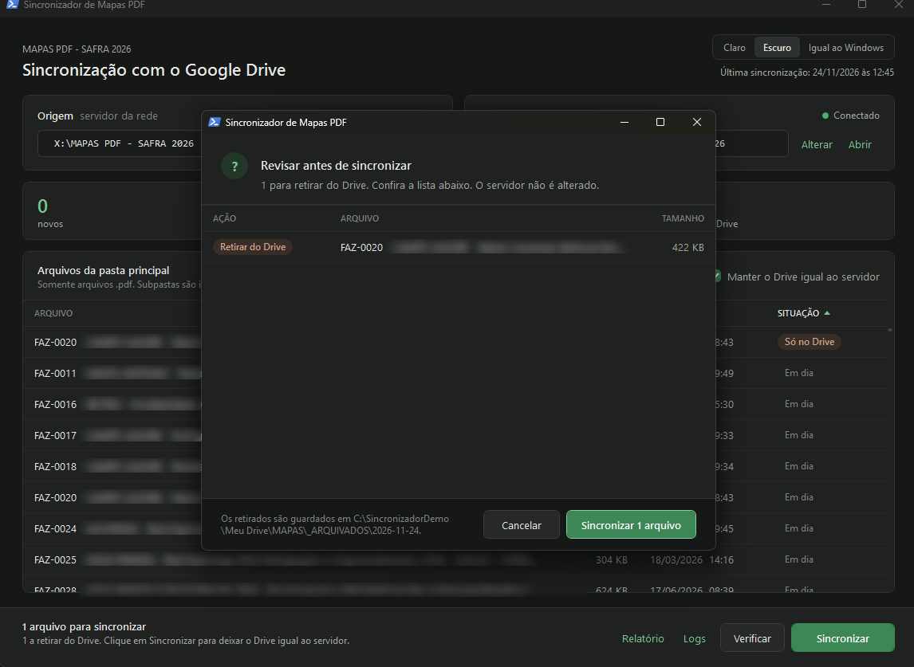
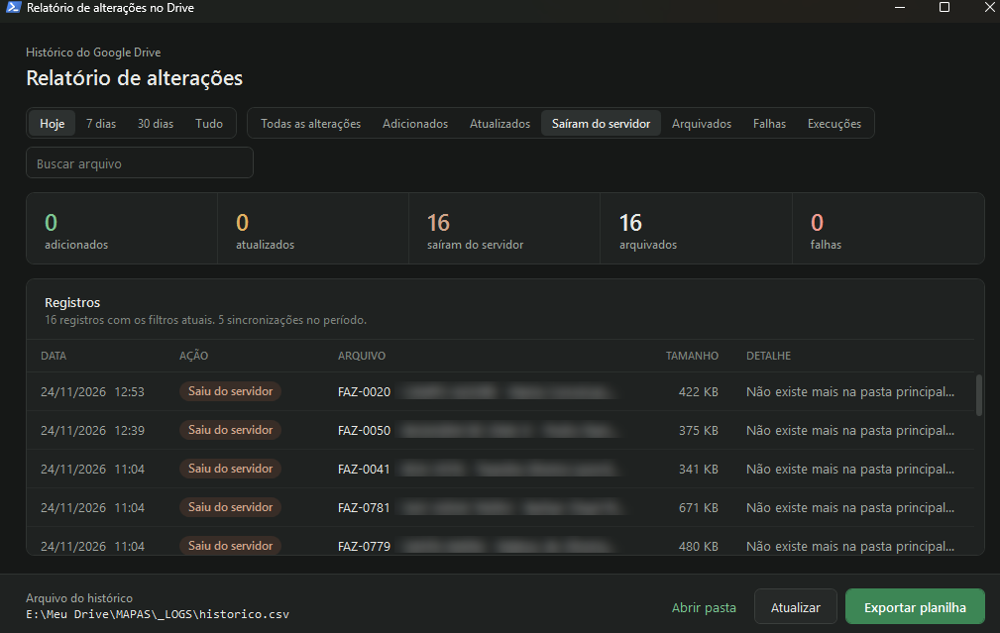
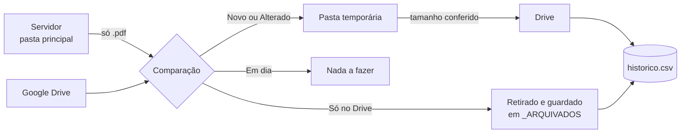
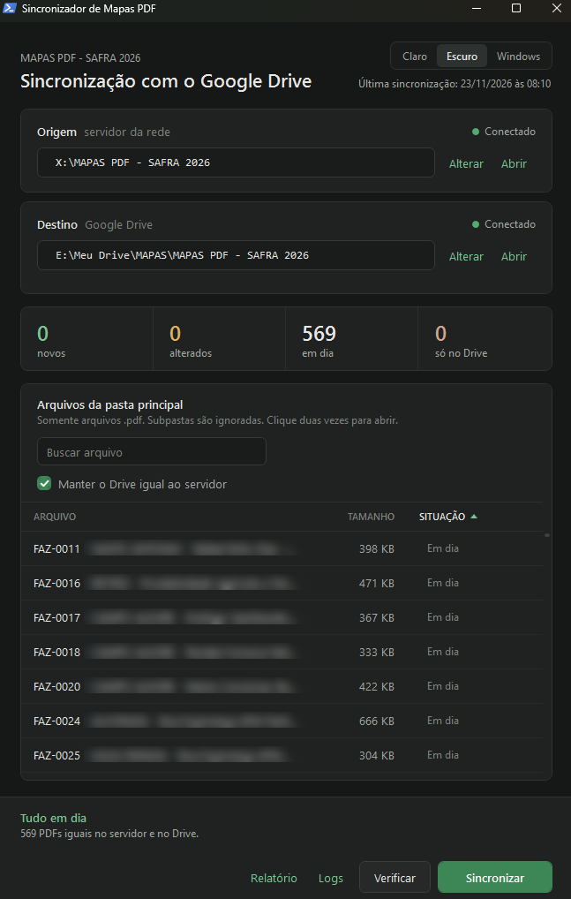

# 🗂️ Sincronizador de Mapas PDF: do servidor da empresa para o Google Drive

Ferramenta para Windows que mantém a pasta de mapas em PDF do servidor interno espelhada no **Google Drive**, para a equipe de campo sempre abrir a versão mais recente. Tem **interface própria com tema claro e escuro**, deixa o Drive com **exatamente os mesmos PDFs do servidor**, **nunca altera o servidor** e guarda um **histórico do que entrou, mudou ou saiu**, com relatório e exportação para Excel.

Começou como um arquivo `.bat` com `robocopy` e foi reescrita do zero em PowerShell com interface WPF, sem nada para instalar.




---

## Resumo

| | |
|---|---|
| **O que é** | Uma janela que compara a pasta de PDFs do servidor com a pasta do Google Drive, copia só o que é novo ou foi alterado e retira do Drive o que saiu do servidor. |
| **Problema que resolve** | O script antigo usava `robocopy /MIR`, que copiava subpastas desnecessárias e **apagava** do Drive tudo o que não aparecesse no servidor, inclusive numa falha de rede. |
| **Destaque** | Cópia em duas etapas (servidor, pasta temporária, Drive) com conferência de tamanho, para nunca subir um PDF pela metade para a nuvem. |
| **Histórico** | Cada alteração vira uma linha num `historico.csv`, consultado por uma tela de relatório com filtros. |
| **Tecnologias** | Windows PowerShell 5.1, WPF/XAML, .NET Framework. Um único script, sem dependências e sem instalação. |
| **Modos** | Interface para uso manual e modo `-Auto` para o Agendador de Tarefas do Windows. |

---

## A ferramenta

Ao abrir, a janela já confere se o servidor e o Drive estão acessíveis e mostra a situação de cada PDF. Nada é copiado até clicar em **Sincronizar**.

| Tema claro | Tema escuro |
|---|---|
|  |  |

| Sincronização concluída | Relatório de alterações |
|---|---|
|  |  |

| Revisão antes de sincronizar | Relatório filtrado |
|---|---|
|  |  |

> Capturas da ferramenta em uso real, com cerca de 570 PDFs. Nomes de pessoas, fazendas e empresas foram borrados. Para testar com dados fictícios, use o script [`ferramentas/preparar-demo.ps1`](ferramentas/preparar-demo.ps1).

### Situação de cada arquivo

| Situação | Significado |
|---|---|
| **Novo** | Existe no servidor e ainda não está no Drive |
| **Alterado** | A versão do servidor é diferente da que está no Drive |
| **Em dia** | Igual nos dois lados, não é copiado de novo |
| **Só no Drive** | Está no Drive, mas não existe mais no servidor. É retirado do Drive e guardado em `_ARQUIVADOS` |
| **Falhou** | Não foi copiado. O motivo aparece ao passar o mouse |

### O que o relatório registra

| Registro | Quando aparece |
|---|---|
| **Adicionado** | Um PDF novo foi enviado ao Drive |
| **Atualizado** | Um PDF existente foi substituído pela versão nova do servidor |
| **Saiu do servidor** | Um PDF deixou de existir no servidor (registrado uma única vez) |
| **Arquivado** | Um PDF foi retirado da pasta do Drive e guardado em `_ARQUIVADOS` |
| **Falha** | Um PDF não pôde ser copiado ou arquivado, com o motivo |
| **Sincronização** | Resumo de cada execução, manual ou automática |

---

## Como a sincronização foi feita

- **Só a pasta principal.** A leitura é feita sem recursão, e a extensão é conferida exatamente: o filtro `*.pdf` do Windows também aceitaria `.pdfx` ou `.pdf_old`. Arquivos ocultos e temporários (`~$`) são ignorados.
- **Comparação por tamanho e data.** Um PDF é "Alterado" se o tamanho mudou ou se a versão do servidor é mais de 2 segundos mais nova. A tolerância cobre a diferença de precisão entre sistemas de arquivos, e o caso "Drive mais novo com o mesmo tamanho" conta como em dia, porque o Google Drive nem sempre preserva a data original.
- **Cópia em duas etapas.** Servidor, pasta temporária local e só então Drive. A parte sujeita a queda é a leitura pela rede; se ela falhar, o PDF da nuvem continua íntegro.
- **Conferências.** Tamanho conferido na pasta temporária e no Drive, e verificação de que o arquivo não foi modificado no servidor durante a cópia. Em caso de falha, até 3 novas tentativas.
- **Links preservados.** O PDF do Drive é sobrescrito no lugar, que o Google Drive trata como nova versão do mesmo arquivo. Apagar e recriar quebraria os links já compartilhados.
- **Trava de execução.** Um `Mutex` global impede duas sincronizações ao mesmo tempo, inclusive entre a janela e a tarefa agendada.
- **"Saiu do servidor" sem repetição.** A lista de PDFs já registrados fica em `estado.json`, para cada saída aparecer uma única vez no histórico.

### Interface sem travar

- A sincronização roda num *runspace* separado. A janela recebe os eventos por uma fila concorrente lida a cada 120 ms.
- O cancelamento é verificado entre um arquivo e outro: nenhum PDF é interrompido no meio.
- O mesmo código do motor é usado pela janela e pelo modo automático.

Os detalhes, com diagramas, estão em [**docs/ARQUITETURA.md**](docs/ARQUITETURA.md).



---

## Funcionalidades

| Funcionalidade | Como funciona |
|---|---|
| Verificação automática | Ao abrir, confere servidor e Drive e mostra os PDFs novos, alterados, em dia e só no Drive |
| Indicadores de conexão | Ponto verde, amarelo ou vermelho para a origem e o destino, com o motivo quando algo está indisponível |
| Ordenação por coluna | Clique em Arquivo, Tamanho, Modificado ou Situação para ordenar; clique de novo para inverter. Por padrão, o que precisa de atenção vem primeiro |
| Números como filtros | Clique em novos, alterados, em dia ou só no Drive para ver só esses arquivos |
| Busca | Filtra a lista pelo nome enquanto você digita |
| Revisão antes de sincronizar | Janela com a lista exata do que será adicionado, atualizado ou retirado do Drive, para confirmar ou cancelar |
| Sincronização com progresso | Barra de progresso, arquivo atual em destaque na lista e botão que vira **Cancelar** |
| Drive igual ao servidor | PDFs que saíram do servidor são retirados da pasta do Drive e guardados em `_ARQUIVADOS\<data>`, com confirmação. Não retira nada se a origem aparecer vazia ou se mais da metade fosse sair de uma vez |
| Relatório | Filtros por período (hoje, 7 dias, 30 dias, tudo), por tipo de registro e busca pelo nome, com totais do período |
| Exportar planilha | Salva os registros filtrados em CSV com `;` e UTF-8, que abre direto no Excel em português |
| Temas | Claro, escuro ou igual ao Windows, com a barra de título acompanhando o tema |
| Layout responsivo | Em janelas estreitas os cartões empilham, colunas secundárias somem e os botões descem |
| Modo automático | `-Auto` para o Agendador de Tarefas, com códigos de saída 0, 1 e 2, e `-Simular` para testar sem alterar nada |
| Logs | Um log por execução, com limpeza automática dos mais antigos que 90 dias |

**Atalhos:** `F5` verifica as pastas (ou recarrega o relatório), `Enter` num campo de caminho confirma a pasta, `Esc` fecha o relatório e duplo clique abre o PDF.

<p align="center">
  
</p>

---

## Como rodar

**Requisitos:** Windows 10 ou 11, Google Drive para computador e acesso de leitura à pasta do servidor. O Windows PowerShell 5.1 já vem no sistema.

1. Baixe pelo botão **Code → Download ZIP**, ou:

   ```powershell
   git clone https://github.com/KaiKe000708/Sync-Drive-PDF-Maps.git
   ```

2. Copie a pasta `src` para um lugar fixo, por exemplo `C:\Ferramentas\SincronizadorMapas`.
3. Clique duas vezes em **`Abrir Sincronizador.bat`**.
4. Na primeira abertura, use **Alterar** para escolher a pasta do servidor e a do Google Drive.

Se a janela não abrir, clique com o botão direito em `SincronizadorMapas.ps1` → **Propriedades** → **Desbloquear**. Outros casos estão em [**docs/SOLUCAO-DE-PROBLEMAS.md**](docs/SOLUCAO-DE-PROBLEMAS.md).

### Testar sem tocar nos arquivos reais

```powershell
powershell -ExecutionPolicy Bypass -File .\ferramentas\preparar-demo.ps1
```

Cria `C:\SincronizadorDemo` com um "servidor" e um "Drive" fictícios, PDFs de exemplo em todas as situações e um histórico de alguns dias. Depois é só abrir `C:\SincronizadorDemo\App\Abrir Sincronizador.bat`.

### Modo automático

```powershell
powershell.exe -NoProfile -ExecutionPolicy Bypass -File "SincronizadorMapas.ps1" -Auto
```

| Código de saída | Significado |
|---|---|
| `0` | Concluído sem falhas |
| `1` | Concluído com falhas ou interrompido |
| `2` | Não executou (origem ou destino indisponível, ou outra execução em andamento) |

Passo a passo do agendamento em [**docs/AGENDAMENTO.md**](docs/AGENDAMENTO.md).

### Configuração

As opções ficam em `config.json`, criado na primeira execução ao lado do script. Há um modelo em [`src/config.exemplo.json`](src/config.exemplo.json).

| Chave | Padrão | Descrição |
|---|---|---|
| `Origem` | | Pasta do servidor. Só os PDFs do primeiro nível são lidos |
| `Destino` | | Pasta dentro do Google Drive |
| `PastaLogs` | | Logs de cada execução e o `historico.csv` |
| `PastaArquivados` | | Para onde vão os PDFs arquivados |
| `EspelharDrive` | `true` | Mantém o Drive igual ao servidor, guardando em `_ARQUIVADOS` os PDFs que saíram |
| `Tema` | `Sistema` | `Claro`, `Escuro` ou `Sistema` |
| `DiasManterLogs` | `90` | Logs mais antigos são removidos. `0` mantém todos. O histórico nunca é apagado |
| `Tentativas` | `3` | Tentativas por arquivo antes de registrar falha |
| `EsperaSegundos` | `5` | Intervalo entre as tentativas |

### Desempenho

- Estilos e cores da interface são carregados uma única vez e compartilhados por todas as janelas, para caixas de mensagem, revisão e relatório abrirem sem atraso.
- A tabela recicla as linhas ao rolar, então listas com centenas de PDFs continuam leves.
- A busca espera você parar de digitar antes de filtrar.
- A leitura das pastas e as cópias rodam fora da janela, que nunca congela.

### Ambiente testado

- Windows 11 com Windows PowerShell 5.1.
- Pasta do servidor acessada por unidade mapeada e por caminho de rede (`\\servidor\...`).
- Google Drive para computador, com a pasta de destino numa letra de unidade.
- Pasta real com cerca de 570 PDFs.

---

## Estrutura

```
├── src/
│   ├── SincronizadorMapas.ps1        # motor, modo automático, interface e relatório
│   ├── Abrir Sincronizador.bat       # abre a interface
│   ├── Sincronizar sem janela.bat    # usado pelo Agendador de Tarefas
│   └── config.exemplo.json           # modelo de configuração
├── ferramentas/
│   └── preparar-demo.ps1             # ambiente fictício para testes e capturas de tela
├── screenshots/                      # capturas usadas neste README
├── docs/
│   ├── ARQUITETURA.md                # como funciona por dentro, com diagramas
│   ├── AGENDAMENTO.md                # passo a passo no Agendador de Tarefas
│   ├── SOLUCAO-DE-PROBLEMAS.md       # erros comuns e onde ficam os registros
│   └── versao-1/                     # o script .bat original, para comparação
├── CHANGELOG.md
├── LICENSE
└── README.md
```

---

## Da versão 1 para a versão 2

| | Versão 1 (`.bat` com `robocopy`) | Versão 2 |
|---|---|---|
| Arquivos copiados | Tudo, com subpastas | Só `.pdf` da pasta principal |
| PDFs que saíram do servidor | Apagados pelo `/MIR` | Retirados do Drive e guardados em `_ARQUIVADOS` |
| Confere servidor e Drive antes | Não | Sim |
| Proteção contra cópia pela metade | Não | Pasta temporária e conferência de tamanho |
| Nome do log | Dependia do formato regional de data | Formato fixo `AAAA-MM-DD_HH-MM-SS` |
| Histórico do que mudou | Não | Relatório com filtros e exportação |
| Interface | Janela de console | Interface própria com temas |
| Agendamento | Manual | Modo `-Auto` com códigos de saída |

O script original, com os caminhos trocados por exemplos, está em [`docs/versao-1`](docs/versao-1).

---

## Decisões de design

- **Paleta:** verde-musgo `#2F6A43` como cor de ação, sobre neutros quentes (`#F3F2EE` no claro, `#161817` no escuro). Cada situação da lista tem a sua cor, sempre acompanhada do texto, nunca só a cor.
- **Tipografia:** Segoe UI, a fonte do próprio Windows, para a interface; Consolas para caminhos de pasta, que precisam ser lidos caractere a caractere.
- **Sóbria de propósito:** sem gradientes, sombras pesadas ou ícones decorativos. É uma ferramenta de trabalho que precisa parecer parte do Windows.
- **Uma ação principal por tela:** só o **Sincronizar** é verde e cheio; os outros botões são secundários ou discretos.
- **Tema por recursos dinâmicos:** todas as cores têm nome (`Fundo`, `Texto`, `Acento`...) e cada tema é uma paleta com os mesmos nomes. Trocar o tema é trocar a paleta.

---

## Observações

- **O servidor nunca é alterado.** A pasta do Drive fica igual à do servidor, e os PDFs retirados do Drive são movidos para `_ARQUIVADOS`, não apagados.
- **O histórico começa na versão 2.1.** Execuções anteriores não aparecem no relatório.
- **"Saiu do servidor" registra a data em que a saída foi notada**, não a data em que o arquivo foi removido do servidor.
- **Precisa do Google Drive para computador** com a pasta acessível por uma letra de unidade. A ferramenta não usa a API do Google.
- Nas capturas, nomes de pessoas, fazendas e empresas foram borrados. Ficaram visíveis só o código de cada arquivo (`FAZ-0011`...) e a versão.

---

## Autor

Desenvolvido por **Kaike Garcia Oliveira**.

- GitHub: [@KaiKe000708](https://github.com/KaiKe000708)

## Licença

O código está sob a licença **MIT** ([`LICENSE`](LICENSE)).
