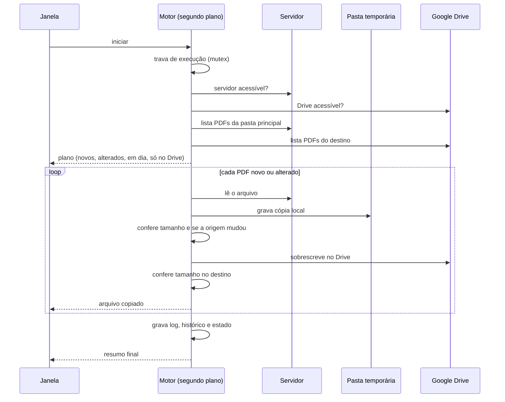
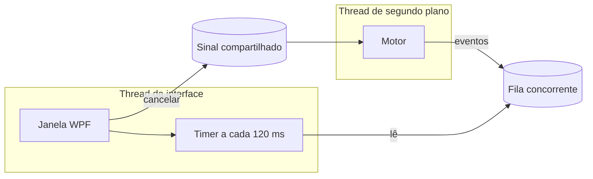

# Arquitetura e decisões técnicas

Este documento explica como o Sincronizador está organizado por dentro e por que algumas escolhas foram feitas.

## Visão geral

Tudo fica num único arquivo, `src/SincronizadorMapas.ps1`, dividido em quatro partes:

| Parte | Responsabilidade |
|---|---|
| Motor | Ler as pastas, comparar, copiar, arquivar, gravar log e histórico |
| Modo automático | Rodar o motor sem janela (`-Auto`) e devolver um código de saída |
| Interface | Janela principal, relatório, temas e layout responsivo |
| Ponte | Rodar o motor em segundo plano e levar os eventos até a tela |

O motor não sabe se está sendo usado pela janela ou pelo Agendador de Tarefas. Ele só emite eventos e escreve no log.

## Por que PowerShell e WPF

- **Nada para instalar.** O Windows PowerShell 5.1 e o .NET Framework já vêm no Windows 10 e 11. Uma solução em Python ou Electron exigiria instalação em cada máquina.
- **WPF** permite uma interface com aparência própria (estilos, temas, layout fluido) usando só bibliotecas do Windows.
- **Um arquivo só** facilita copiar a ferramenta entre computadores e auditar o que ela faz.

## Fluxo de uma sincronização



## Regra de comparação

Para cada PDF da pasta principal do servidor:

| Situação | Resultado |
|---|---|
| Não existe no Drive | Novo |
| Tamanho diferente | Alterado |
| Mesmo tamanho, versão do servidor mais de 2 segundos mais nova | Alterado |
| Mesmo tamanho, Drive igual ou mais novo | Em dia |

A tolerância de 2 segundos existe porque sistemas de arquivos diferentes guardam a data com precisões diferentes.

O caso "Drive mais novo com o mesmo tamanho" é tratado como em dia de propósito. Alguns sistemas de arquivos virtuais, como o do Google Drive, nem sempre preservam a data de modificação original. Sem essa regra, o mesmo PDF seria copiado de novo a cada execução.

## Cópia segura

A cópia de um arquivo segue estes passos:

1. Lê tamanho e data do arquivo no servidor.
2. Copia para uma pasta temporária local (`%TEMP%`).
3. Confere se o tamanho da cópia bate.
4. Confere se o arquivo do servidor não mudou durante a cópia.
5. Remove o atributo somente leitura do destino, se houver.
6. Copia da pasta temporária para o Drive, sobrescrevendo.
7. Confere o tamanho no Drive.
8. Ajusta a data do arquivo no Drive para a mesma do servidor.

Se qualquer passo falhar, a cópia é repetida até o limite de tentativas configurado.

**Por que a pasta temporária:** a parte lenta e sujeita a falhas é a leitura pela rede. Se a rede cair, o problema fica na pasta temporária e o PDF do Drive continua íntegro. A etapa final é uma cópia local e rápida.

**Por que sobrescrever em vez de apagar e criar de novo:** o Google Drive trata a sobrescrita como uma nova versão do mesmo arquivo. Apagar e recriar poderia gerar um arquivo novo, quebrando os links já compartilhados com a equipe.

## Interface sem travar



- O motor roda num *runspace* separado do PowerShell.
- Ele publica eventos (`ambiente`, `plano`, `item`, `progresso`, `log`, `fim`) numa `ConcurrentQueue`.
- Um `DispatcherTimer` na thread da janela consome a fila e atualiza a tela.
- O cancelamento é um sinal numa hashtable sincronizada, verificado entre um arquivo e outro. Um arquivo nunca é interrompido no meio.

O código do motor fica num texto que é carregado nos dois lugares: no script principal (modo automático) e no runspace (interface). Assim existe uma única implementação.

## Trava de execução

Um `Mutex` nomeado no espaço global do Windows impede duas sincronizações ao mesmo tempo, inclusive entre a janela e a tarefa agendada rodando em sessões diferentes. Se o processo dono for encerrado à força, o mutex abandonado é detectado e liberado.

## Histórico

Cada alteração vira uma linha em `historico.csv`, na pasta de logs:

```
"Data e hora";"Execução";"Ação";"Arquivo";"Bytes";"Detalhe"
"2026-11-24 10:15:02";"2026-11-24 10:15:00";"Adicionado";"Mapa Talhao 07.pdf";"184233";"Versão do servidor de 24/11/2026 09:58."
```

- Separador `;` e codificação UTF-8 com BOM, para abrir direto no Excel em português.
- A coluna "Execução" agrupa as linhas de uma mesma sincronização.
- "Saiu do servidor" é registrado uma única vez por arquivo. A lista de arquivos já registrados fica em `estado.json`.
- Se a pasta de logs estiver inacessível, logs e histórico vão para `%LOCALAPPDATA%\SincronizadorMapas\Logs`. O relatório lê os dois lugares.

## Temas

- Todas as cores da interface são recursos dinâmicos (`DynamicResource`) com nomes como `Fundo`, `Texto`, `Acento`.
- Cada tema é uma paleta com os mesmos nomes. Trocar o tema é substituir os valores no dicionário de recursos das janelas abertas.
- O modo "Igual ao Windows" lê `AppsUseLightTheme` no registro e confere de novo sempre que a janela recebe foco.
- A barra de título escura usa `DwmSetWindowAttribute`. Se a chamada não for suportada, a janela segue com a barra padrão.

Detalhe de implementação: no PowerShell, objetos criados com `New-Object` chegam embrulhados num `PSObject`. Ao colocar um pincel assim no dicionário de recursos, o WPF não o reconhece como cor. Por isso os pincéis são criados com `[SolidColorBrush]::new()`.

## Compatibilidade

O código evita recursos exclusivos do PowerShell 7 (operadores `??`, `?.`, ternário, `&&`, `ForEach-Object -Parallel`) para rodar no Windows PowerShell 5.1 que vem no sistema.

Os arquivos `.ps1` são salvos em UTF-8 com BOM. Sem o BOM, o PowerShell 5.1 lê o arquivo como ANSI e os acentos da interface aparecem quebrados. O `.gitattributes` do repositório preserva as quebras de linha do Windows.
